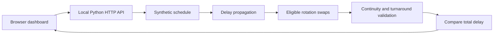
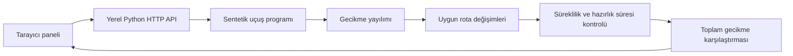

# AirOps — Airline Disruption Recovery Lab

[English](#english) | [Türkçe](#türkçe)

## English

A reproducible decision-support prototype that shows how an aircraft delay propagates through a daily flight schedule and evaluates aircraft rotation swaps to reduce total flight-delay minutes.

Built for an aviation engineering portfolio. All aircraft, flight numbers and schedules are synthetic. Airport codes represent real locations; the schedule does not represent any airline.

## Run in one command

Python 3.11+; no third-party packages, API keys or accounts required.

```bash
python3 -m airops
```

Open http://127.0.0.1:8000. Select a flight, inject 0–240 minutes of delay and compare the original assignment with the recovery recommendation. Use `--port 8001` if the default port is busy.

## What it demonstrates

- A 40-flight, 10-aircraft synthetic schedule across SAW, ADB, AYT, ESB, BJV and DLM.
- Deterministic delay propagation with airport continuity and a 35-minute minimum turnaround.
- Exhaustive enumeration of eligible pairs of remaining rotations, with feasibility validation.
- A baseline-versus-recovery aircraft timeline and flight-level assignment table.
- Explainable recommendations and explicit no-improvement outcomes.
- Standard-library HTTP API and automated constraint tests in GitHub Actions.

## Model and objective

For each aircraft's next flight:

```text
actual departure = max(scheduled departure + direct disruption,
                       previous actual arrival + minimum turnaround)
total delay = sum(actual departure − scheduled departure)
```

The direct disruption is flight-specific and applied before candidate swaps; candidates begin strictly after the disrupted flight's scheduled departure. Each candidate exchanges the complete remaining rotations of two same-fleet aircraft whose suffixes begin at the same airport. The simulator rejects discontinuous rotations and delays subsequent departures until the assigned aircraft can complete its turnaround. The search keeps the feasible candidate with the lowest total delay, and retains the baseline if none improves it. Ties keep the first candidate in deterministic enumeration order.

This is a constrained single-swap search, not a globally optimal fleet recovery solver. The objective counts flight-delay minutes, not passenger delay, money or cancellation costs. Departure-time ordering fixes each tail's flight sequence; overtaking within a rotation is not modeled.

## Architecture



`airops/engine.py` contains the simulation and search. `airops/__main__.py` serves the API and local dashboard. `airops/dashboard.html` renders the controls, metrics and timeline without external assets.

## Reproduce and test

```bash
python3 -m unittest discover -s tests -v
python3 -c 'from airops.engine import schedule, recover; print(recover(schedule(), "AO001", 90)["metrics"])'
```

The tests cover zero-delay behavior, exact propagation, an improving recovery, invalid inputs, and independent continuity/turnaround checks across multiple scenarios. CI is configured for Python 3.11–3.13; local execution results depend on the installed interpreter.

API example: `GET /api/scenario?flight=AO001&delay=90`. Response includes `baseline`, `recovered`, `decision` and `metrics`. Invalid scenario inputs return HTTP 400.

## Limitations and next experiments

This educational prototype omits crew legality, maintenance, airport slots, curfews, passenger connections, cancellations, fleet performance differences and stochastic travel times. All flights use the same A320 fleet and a constant 75-minute duration, on one local operating day. Candidate feasibility applies only to the constraints implemented here. The local server is for development.

Potential extensions: compare a mixed-integer or CP-SAT model against this baseline; add passenger-weighted costs; evaluate recovery under sampled disruption scenarios; train a delay model on a documented, appropriately licensed historical dataset with time-based train/test splits. No predictive ML performance is claimed by this version.

---

## Türkçe

### Proje hakkında

AirOps, bir uçaktaki gecikmenin günlük uçuş programına nasıl yayıldığını gösteren ve toplam uçuş gecikmesini azaltmak için uçakların kalan rotalarını değiştirmeyi değerlendiren, sonuçları tekrar üretilebilir bir karar destek prototipidir.

Havacılık mühendisliği portföyü için geliştirilmiştir. Tüm uçaklar, uçuş numaraları ve uçuş programları sentetiktir. Havalimanı kodları gerçek yerleri gösterir; program herhangi bir havayoluna ait değildir.

### Tek komutla çalıştırma

Python 3.11 veya üzeri yeterlidir. Üçüncü taraf paket, API anahtarı veya hesap gerekmez. Proje klasöründe şu komutu çalıştırın:

```bash
python3 -m airops
```

Tarayıcıda http://127.0.0.1:8000 adresini açın. Bir uçuş seçin, 0–240 dakika gecikme ekleyin ve mevcut uçak atamalarını sistemin iyileştirme önerisiyle karşılaştırın. Varsayılan port doluysa `python3 -m airops --port 8001` komutunu kullanın.

### Neler gösteriyor?

- SAW, ADB, AYT, ESB, BJV ve DLM havalimanları arasında 10 uçak ve 40 uçuştan oluşan sentetik program.
- Uçağın havalimanı sürekliliğini ve en az 35 dakikalık yerde hazırlık süresini dikkate alan deterministik gecikme yayılımı.
- Uygun kalan rota çiftlerinin tamamının denenmesi ve her adayın uygulanabilirliğinin kontrol edilmesi.
- Mevcut plan ile iyileştirilmiş planı karşılaştıran uçak zaman çizelgesi ve uçuş bazında atama tablosu.
- Açıklanabilir öneriler ve iyileştirme bulunamadığında mevcut planın korunması.
- Python standart kütüphanesiyle HTTP API ve GitHub Actions üzerinden otomatik kısıt testleri.

### Model ve amaç

Her uçağın sıradaki uçuşu için:

```text
gerçek kalkış = max(planlanan kalkış + doğrudan gecikme,
                   önceki gerçek varış + minimum yerde hazırlık süresi)
toplam gecikme = toplam(gerçek kalkış − planlanan kalkış)
```

Doğrudan gecikme seçilen uçuşa aittir ve aday rota değişimlerinden önce uygulanır. Değiştirilecek rotalar, geciken uçuşun planlanan kalkışından kesinlikle sonra başlamalıdır. Her aday, aynı filodaki iki uçağın aynı havalimanından başlayan kalan rotalarının tamamını karşılıklı değiştirir. Simülatör, uçağın önceki varış havalimanıyla sonraki kalkış havalimanı uyuşmayan rotaları reddeder; sonraki kalkışları gerekli yerde hazırlık süresi tamamlanana kadar erteler. Arama, toplam gecikmesi en düşük uygulanabilir adayı seçer. Hiçbir aday iyileştirme sağlamazsa mevcut plan korunur. Eşit sonuçlarda deterministik deneme sırasındaki ilk aday kalır.

Bu yöntem, kısıtlı bir tek rota değişimi aramasıdır; tüm filo için küresel optimum garantisi vermez. Amaç fonksiyonu uçuş gecikme dakikalarını toplar; yolcu gecikmesini, parasal maliyeti veya iptal maliyetini hesaplamaz. Her uçağın uçuş sırası planlanan kalkış saatlerine göre sabittir; bir rotadaki uçuşların birbirini geçmesi modellenmez. Mevcut sürüm tahmin yapan bir yapay zekâ modeli kullanmaz.

### Mimari



`airops/engine.py` simülasyonu ve arama algoritmasını içerir. `airops/__main__.py` API'yi ve yerel paneli sunar. `airops/dashboard.html` kontrolleri, metrikleri ve zaman çizelgesini haricî dosya veya hizmet gerektirmeden gösterir.

### Sonuçları yeniden üretme ve testler

```bash
python3 -m unittest discover -s tests -v
python3 -c 'from airops.engine import schedule, recover; print(recover(schedule(), "AO001", 90)["metrics"])'
```

Testler; gecikmesiz durumu, gecikmenin tam yayılımını, iyileştirme sağlayan bir senaryoyu, geçersiz girdileri ve birden fazla senaryoda bağımsız havalimanı sürekliliği/yerde hazırlık süresi kontrollerini kapsar. GitHub Actions, Python 3.11–3.13 için yapılandırılmıştır; yerel testler kurulu Python yorumlayıcısıyla çalışır.

API örneği: `GET /api/scenario?flight=AO001&delay=90`. Yanıt; mevcut planı (`baseline`), iyileştirilmiş planı (`recovered`), kararı (`decision`) ve metrikleri (`metrics`) içerir. Geçersiz senaryo girdilerinde HTTP 400 döner.

### Sınırlamalar ve sonraki çalışmalar

Bu eğitim prototipi; mürettebat çalışma kurallarını, bakımı, havalimanı slotlarını, gece uçuş kısıtlarını, yolcu bağlantılarını, iptalleri, filo performans farklarını ve rastlantısal uçuş sürelerini kapsamaz. Tüm uçuşlar aynı A320 filosunu ve sabit 75 dakikalık uçuş süresini kullanır; zamanlar tek bir yerel operasyon gününe aittir. Adayların uygulanabilirliği yalnızca burada uygulanan kısıtlara göre değerlendirilir. Yerel sunucu geliştirme amaçlıdır; proje gerçek operasyonlarda kullanıma uygunluk iddiası taşımaz ve hiçbir havayolunun resmî ürünü değildir.

Olası geliştirmeler: karma tamsayılı programlama veya CP-SAT modelini mevcut yöntemle karşılaştırmak; yolcu ağırlıklı maliyetler eklemek; örneklenmiş aksaklık senaryolarında iyileştirmeyi değerlendirmek; belgelenmiş ve uygun lisanslı geçmiş verilerle, zamana dayalı eğitim/test ayrımı kullanarak gecikme tahmin modeli eğitmek. Bu sürüm herhangi bir makine öğrenmesi tahmin başarısı iddia etmez.
