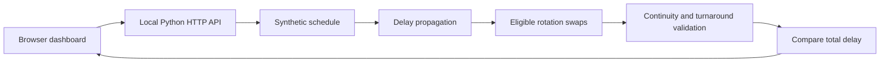

# AirOps — Airline Disruption Recovery Lab

A reproducible decision-support prototype that shows how an aircraft delay propagates through a daily flight schedule and evaluates aircraft rotation swaps to reduce total flight-delay minutes.

Built for an aviation engineering portfolio. All aircraft, flight numbers and schedules are synthetic. Airport codes represent real locations; the schedule does not represent any airline.

## Run in one command

Python 3.11+; no third-party packages, API keys or accounts required.

```bash
python3 -m airops
```

Open http://127.0.0.1:8000. Select a flight, inject 0–240 minutes of delay and compare the original assignment with the recovery recommendation. Use `--port 8001` if the default port is busy.

## What it demonstrates

- A 40-flight, 10-aircraft synthetic schedule across SAW, ADB, AYT, ESB, BJV and DLM.
- Deterministic delay propagation with airport continuity and a 35-minute minimum turnaround.
- Exhaustive enumeration of eligible pairs of remaining rotations, with feasibility validation.
- A baseline-versus-recovery aircraft timeline and flight-level assignment table.
- Explainable recommendations and explicit no-improvement outcomes.
- Standard-library HTTP API and automated constraint tests in GitHub Actions.

## Model and objective

For each aircraft's next flight:

```text
actual departure = max(scheduled departure + direct disruption,
                       previous actual arrival + minimum turnaround)
total delay = sum(actual departure − scheduled departure)
```

The direct disruption is flight-specific and applied before candidate swaps; candidates begin strictly after the disrupted flight's scheduled departure. Each candidate exchanges the complete remaining rotations of two same-fleet aircraft whose suffixes begin at the same airport. The simulator rejects discontinuous rotations and delays subsequent departures until the assigned aircraft can complete its turnaround. The search keeps the feasible candidate with the lowest total delay, and retains the baseline if none improves it. Ties keep the first candidate in deterministic enumeration order.

This is a constrained single-swap search, not a globally optimal fleet recovery solver. The objective counts flight-delay minutes, not passenger delay, money or cancellation costs. Departure-time ordering fixes each tail's flight sequence; overtaking within a rotation is not modeled.

## Architecture



`airops/engine.py` contains the simulation and search. `airops/__main__.py` serves the API and local dashboard. `airops/dashboard.html` renders the controls, metrics and timeline without external assets.

## Reproduce and test

```bash
python3 -m unittest discover -s tests -v
python3 -c 'from airops.engine import schedule, recover; print(recover(schedule(), "AO001", 90)["metrics"])'
```

The tests cover zero-delay behavior, exact propagation, an improving recovery, invalid inputs, and independent continuity/turnaround checks across multiple scenarios. CI is configured for Python 3.11–3.13; local execution results depend on the installed interpreter.

API example: `GET /api/scenario?flight=AO001&delay=90`. Response includes `baseline`, `recovered`, `decision` and `metrics`. Invalid scenario inputs return HTTP 400.

## Limitations and next experiments

This educational prototype omits crew legality, maintenance, airport slots, curfews, passenger connections, cancellations, fleet performance differences and stochastic travel times. All flights use the same A320 fleet and a constant 75-minute duration, on one local operating day. Candidate feasibility applies only to the constraints implemented here. The local server is for development.

Potential extensions: compare a mixed-integer or CP-SAT model against this baseline; add passenger-weighted costs; evaluate recovery under sampled disruption scenarios; train a delay model on a documented, appropriately licensed historical dataset with time-based train/test splits. No predictive ML performance is claimed by this version.

## Türkçe

AirOps, sentetik bir uçuş programında gecikmenin yayılmasını hesaplar ve uyumlu uçakların kalan rotalarını değiştirerek toplam gecikmeyi azaltmayı dener. Kurulum için Python yeterlidir: `python3 -m airops`. Bu proje hiçbir havayolunun resmî ürünü değildir; gerçek operasyon verisi veya üretim kullanımına uygunluk iddiası içermez.
